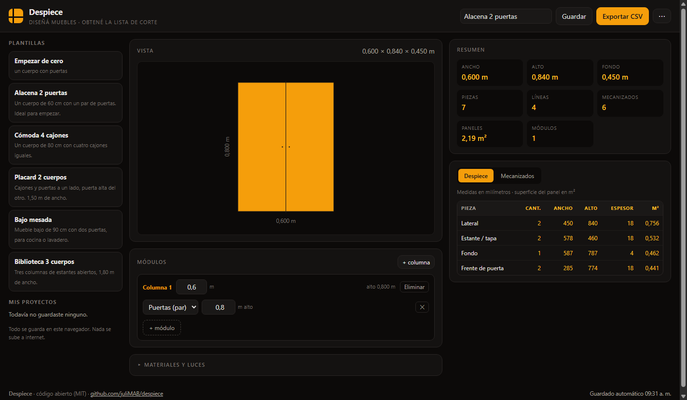
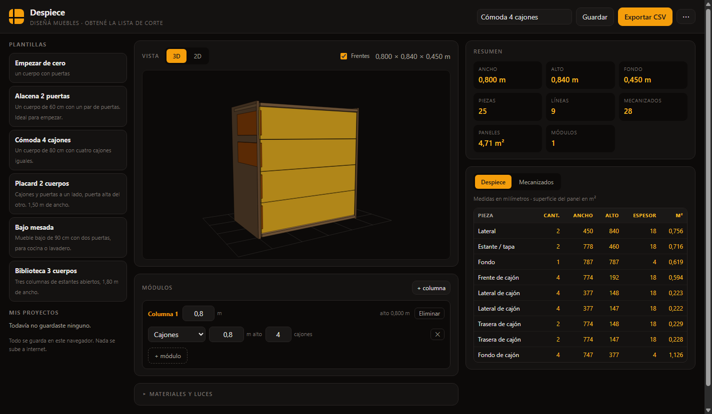
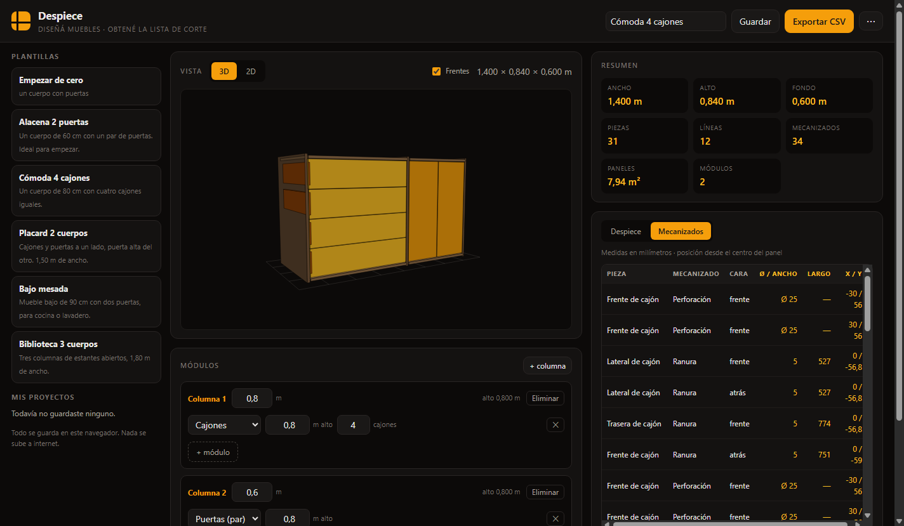

# Despiece

**Diseñá muebles y obtené la lista exacta de piezas para cortar.** Libre, gratuito y sin cuentas ni backend.

> Estado: **v0.2 — editor web funcionando**.
> Repositorio **privado por ahora**: la publicación está diferida hasta que el proyecto tenga identidad propia y suficiente diferencia con la app de referencia que inspiró la recuperación.



## Probarlo (local)

La app es estática y no tiene build: alcanza con servir la carpeta.

```bash
git clone https://github.com/juliMAB/despiece.git
cd despiece
npm run serve      # http://127.0.0.1:8080
```

Abrís `http://127.0.0.1:8080`, elegís una plantilla y empezás a editar. Todo se calcula en tu navegador y los proyectos se guardan en tu propio equipo.

## Qué hace

- **Editor visual**: agregá y quitá columnas, cambiá anchos, agregá módulos de puertas (par o simple), cajones o estantes, con su alto y cantidad de cajones.
- **Despiece en vivo**: cada cambio recalcula todas las piezas con sus medidas exactas de corte.
- **Resumen**: medidas exteriores, cantidad de piezas, líneas de corte, mecanizados y superficie de panel.
- **Mecanizados**: perforaciones de tiradores (Ø y posición) y ranuras de fondo, pieza por pieza.
- **Avisos**: si un diseño no cierra (cajones que no entran, puertas demasiado angostas) te lo dice con el motivo.
- **Exportar CSV** del despiece, listo para planilla o para el aserradero.
- **Exportar / importar diseño** en JSON.
- **Guardado local**: proyectos en `localStorage`, sin cuentas ni servidores.
- **5 plantillas** para arrancar (alacena, cómoda, placard, bajo mesada, biblioteca).

| Cómoda de 4 cajones | Mecanizados |
|---|---|
|  |  |

## Modelo de diseño

Medidas en **metros**. Un diseño es:

```js
{
  columns: [
    {
      width: 0.6,                 // ancho de la columna
      modules: [                  // apilados de abajo hacia arriba
        { id: "a", type: "doors",  height: 0.8 },
        { id: "b", type: "drawer", height: 0.5, drawerCount: 2 },
        { id: "c", type: "shelf",  height: 0.3 },
      ],
    },
  ],
  config: {                       // opcional: sobrescribe los valores por defecto
    depth: 0.45,
    panelThickness: 0.018,
    // …ver src/engine/config.js
  },
}
```

Tipos de módulo: `doors` (par de puertas), `left-door` / `right-door` (una hoja con bisagra), `drawer` (pila de cajones), `shelf` (estante abierto).

## Como librería

```js
import { compileFurniture, buildCutlist, cutlistToCsv } from "./src/index.js";

const resultado = compileFurniture({
  columns: [{ width: 0.6, modules: [{ id: "puertas", type: "doors", height: 0.8 }] }],
});

resultado.parts.length;      // 7 piezas
resultado.operations.length; // 6 mecanizados
buildCutlist(resultado.parts); // lista agrupada
cutlistToCsv(buildCutlist(resultado.parts));
```

## Estructura

```
index.html          app web (sin build)
styles.css
src/
  engine/           motor de despiece (independiente de la UI)
    config.js       parámetros de fabricación y precisión (1 mm)
    compile.js      diseño → piezas, mecanizados, avisos
    cutlist.js      agrupado, resumen y CSV
  ui/               editor (sin frameworks)
    app.js          lógica y eventos
    render2d.js     diagrama del mueble
    storage.js      proyectos en localStorage
    dom.js          helpers
  index.js          API pública
templates/          plantillas propias
test/               tests del motor y del despiece (+ snapshots)
dev/                herramientas de desarrollo (servidor, pruebas de UI, snapshots)
docs/               documentación técnica
```

El motor no depende del navegador: se usa igual en Node o en la web.

## Tests

```bash
npm test          # 57 tests del motor, despiece y plantillas
npm run ui-check  # 12 verificaciones de la interfaz con Chrome
```

El motor fue validado pieza por pieza contra la salida observada de una app de referencia desaparecida (ver [docs/ARQUITECTURA.md](docs/ARQUITECTURA.md)): coincide en cantidad, posición y tamaño de cada pieza y en cada mecanizado.

## Roadmap

| Versión | Contenido | Estado |
|---|---|---|
| v0.1 | Motor de despiece + despiece agrupado + CSV + tests | ✅ |
| v0.2 | Editor visual, plantillas, guardado local, import/export | ✅ |
| v0.3 | Visor 3D interactivo | 🚧 |
| v0.4 | Materiales y espesores por proyecto, optimización de corte, PDF de planos | ⏳ |
| v1.0 | PWA offline, historial de cambios, más tipos de mueble | ⏳ |
| — | **Publicación pública** (Pages, dominio, difusión) | ⏸ diferida |

La publicación queda **en pausa a propósito**: primero el proyecto tiene que diferenciarse de la app de referencia que se usó para reconstruir el motor (identidad visual propia, funciones que el original no tenía, documentación y licencia claras), y recién después se abre al público.

## Origen

Despiece nace de la recuperación de **madera.app**, una app de diseño de muebles que existió unos meses de 2026 y cuyo servidor desapareció. Se rescataron sus datos y su comportamiento observable, y este proyecto **reimplementa el motor desde cero** con código propio, sin incluir material del autor original. La validación se hizo comparando la salida del motor propio contra la salida observada del original.

## Licencia

[MIT](LICENSE). Usalo, modificalo y compartilo libremente.
